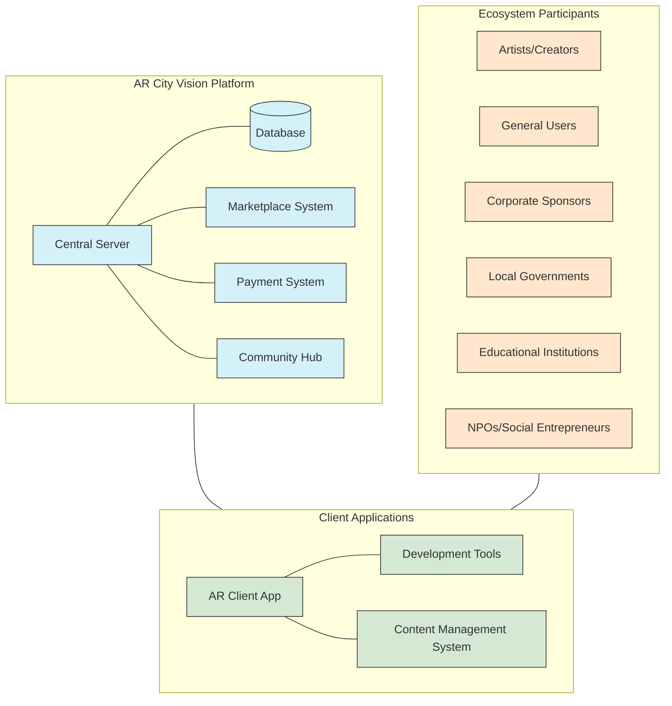
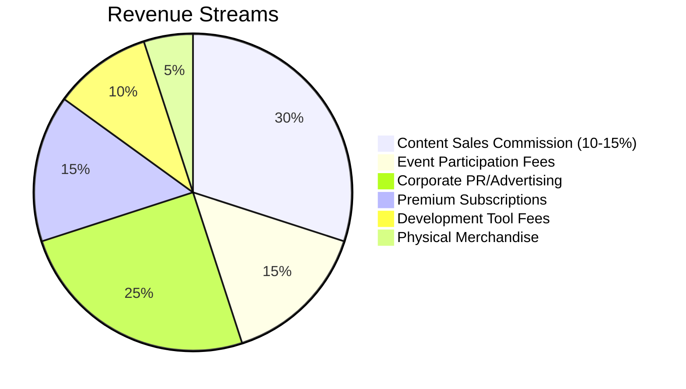
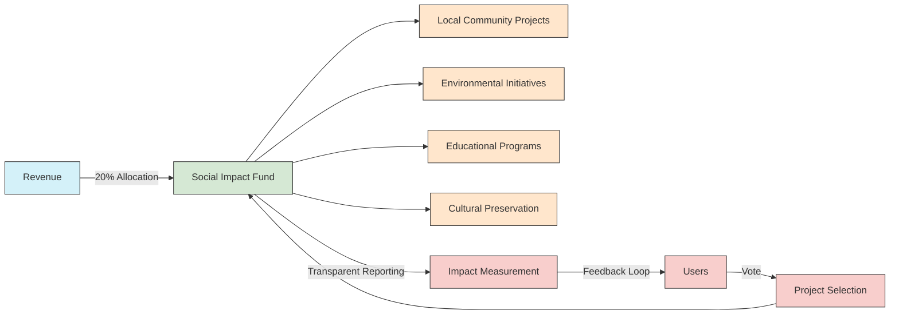

# AR City Vision Project

<a href="#japanese-readme">日本語READMEへ</a>

**🌆 Creating sustainable future cities through AR technology 🌆**

## 📋 Overview

The AR City Vision Project is an open-source initiative that leverages Augmented Reality (AR) technology to address various urban and regional challenges, creating a sustainable and vibrant future. Our platform allows artists, developers, local governments, and citizens to collaboratively design and experience AR content in real urban spaces.

Similar to a Minecraft AR version for cities, our platform provides a server where users can design various urban experiences. As more people gather on the server, artists can generate revenue by setting participation fees or receiving sponsorship from businesses looking to promote themselves, creating a sustainable ecosystem for creative AR content development.

> 💡 Our platform takes a small commission fee to support operational costs and nonprofit activities, enabling everyone to contribute to social impact while participating in an engaging AR experience.

## 🎯 Vision & Mission

### Vision
**Creating a bright future where people, regions, and nature shine through AR technology**

### Mission
We utilize AR technology to promote sustainable urban development, tourism revitalization, regional activation, and innovation in education and welfare that leverages regional characteristics. Through these activities, we aim to rejuvenate local communities and cultivate artists, creating a society filled with creativity and diversity where people can live with rich hearts.

## 🏙️ Platform Structure

## 🌐 Ecosystem Model

Our AR City Vision project creates a virtuous cycle ecosystem where all participants benefit while contributing to social impact:

### 👥 Participant Roles & Benefits

| Participant | Role | Benefits |
|-------------|------|----------|
| 🎨 **Artists/Creators** | Create AR spaces, experiences, and content | Revenue from content sales, commissions, recognition, collaboration opportunities |
| 👤 **General Users** | Experience AR content, participate in events | New AR experiences, social contribution, community participation |
| 🏢 **Corporate Sponsors** | Provide PR spaces, sponsor events | Targeted audience reach, innovation branding, CSR opportunities |
| 🏛️ **Local Governments** | Provide urban spaces, local data | Citizen engagement, tourism promotion, smart city initiatives |
| 🎓 **Educational Institutions** | Research, education, talent development | Practical learning environments, research data, industry connections |
| 🤝 **NPOs/Social Entrepreneurs** | Address social issues through AR | Funding, visibility, supporter acquisition |

### 💹 Revenue Model

### 🔄 Social Impact Mechanism

## 🚀 How to Participate

### For Developers
- 💻 Fork this repository
- 🔧 Set up your development environment following our [setup guide](docs/setup.md)
- 🤝 Check out [CONTRIBUTING.md](CONTRIBUTING.md) for contribution guidelines
- 🐛 Find issues to work on in our [Issues](https://github.com/ar-city-vision/ar-city-vision-project/issues) page

### For Artists/Creators
- 🎨 Apply to our [Creator Program](docs/creator-program.md)
- 🛠️ Use our development tools to create AR experiences
- 🏆 Participate in AR contests and exhibitions
- 👥 Join our creator community for collaboration opportunities

### For Local Governments
- 🤝 Become a partner municipality for pilot projects
- 🏙️ Provide urban spaces for AR experiences
- 📊 Share open data for AR content development
- 🧠 Collaborate on solving local challenges through AR

### For Companies
- 💼 Sponsor AR experiences or events
- 🔍 Explore PR opportunities within AR spaces
- 👨‍💼 Provide expertise and resources
- 🌱 Support social impact initiatives through our platform

### For Users
- 📱 Download the AR client app
- 👁️ Experience AR content in your city
- 💬 Provide feedback to creators
- 🗳️ Vote for social impact projects to support

## 🔧 Technology Stack

| Category | Technologies |
|----------|-------------|
| **🖥️ Backend** | Node.js, Express, GraphQL, PostgreSQL, Redis |
| **📱 Frontend** | React Native, Three.js, AR.js, WebXR |
| **☁️ Cloud Services** | AWS/GCP, Serverless, Kubernetes |
| **🔐 Authentication** | OAuth 2.0, JWT, Biometric Auth |
| **💰 Payment** | Stripe, Cryptocurrency Integration |
| **🔄 CI/CD** | GitHub Actions, Docker, Terraform |
| **🧠 AI/ML** | TensorFlow, PyTorch, Computer Vision APIs |
| **📊 Analytics** | ELK Stack, Prometheus, Grafana |

## 👨‍👩‍👧‍👦 Team

| Role | Name | GitHub | 
|------|------|--------|
| **👑 Founder/Representative** | Naoya Kusunoki | [@t012093](https://github.com/t012093) |
| **💻 Technical Leader** | Naoya Kusunoki | [@t012093](https://github.com/t012093) |
| **🤝 Co-founder/Technical Leader** | [Recruiting] | - |
| **🧠 Advisors** | [Recruiting] | - |
| **🏛️ Municipality Liaison** | Naoya Kusunoki + [Recruiting] | - |
| **🎨 Artist Relations** | [Recruiting] | - |

## 📜 License

This project is licensed under the MIT License - see the [LICENSE](LICENSE) file for details.

## 📞 Contact

For questions, suggestions, or collaboration inquiries, please [open an issue](https://github.com/ar-city-vision/ar-city-vision-project/issues) on this repository.

---

