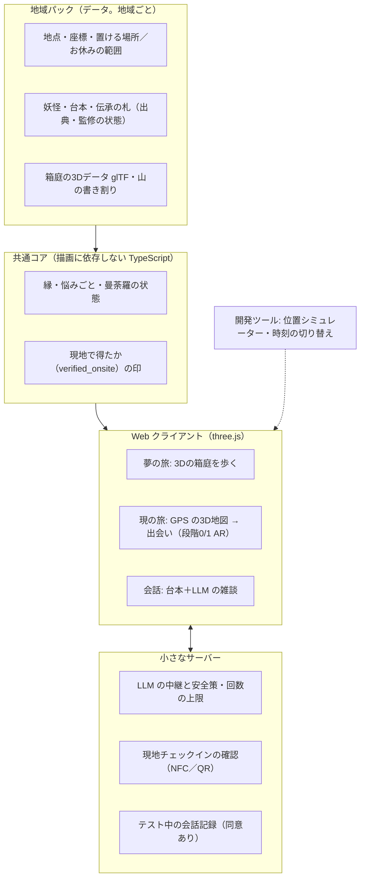

# 全体整理とロードマップ v0.1

> 作成日: 2026-10-16 ／ ステータス: **提案（PO の確認待ち）**
> 00〜04 の内容と、10/16 の議論（家から遊ぶモード、3D の見た目、現地限定の「行った証」）を一本にまとめたもの。
> **00〜04 と食い違うところは、この文書を優先する**（直す箇所は §10）。

## 1. ひとことで

**家では、立山の3Dの箱庭を歩いて妖怪の物語を聞く。現地では、同じ場所に本当に立って、その妖怪に「再会」する。**
three.js で作る Web ゲームで、PC とスマホの両方で遊べる。最初の地域は立山・富山で、あとから他の地域を「地域パック」として足していく。

## 2. 決まっていること（決定ログ）

| 日付 | 項目 | 内容 | 文書 |
|---|---|---|---|
| 10/16 | ターゲット | 20〜40代の「和もの好き」の大人 | 02 |
| 10/16 | トーン | やさしさが基調で、ときどき畏れ | 02 |
| 10/16 | 地域 | 立山・富山。MVP の舞台は「麓」（岩峅寺・芦峅寺）と「里」の一部 | 02 |
| 10/16 | 事業 | 基本無料＋地域タイアップ | 02 |
| 10/16 | 技術 | three.js による Web ファースト | 01 |
| 10/16 | **家のモード** | 家から遊ぶモード（夢の旅）を主要モードにする。地域を選んで、3Dの箱庭に入って歩ける | 本書 |
| 10/16 | **見た目** | ポケモンGOより立体的な、ゲームらしい3D。参考画像ボードの方向で進める | 本書 |
| 10/16 | **現地限定** | 現地に行った人だけが手に入れられる「行った証」を作る | 本書 |
| 10/16 | **世界展開** | 遊べる地域を選んで入る形にし、地域パックを増やして広げる | 本書 |

## 3. ゲームの全体像：二つの旅

| | 夢の旅（家・PC／スマホ） | 現の旅（現地・スマホ） |
|---|---|---|
| 入り方 | 地域を選ぶ → その土地の3Dの箱庭に入る | 現地で GPS の3D地図を開く |
| 動き方 | アバター（絵解き師の見習い）と相棒のましろで歩く | 自分の足で歩く。立ち止まると妖怪が現れる |
| 妖怪の姿 | 白描（墨の線だけ）の「夢の姿」。声は台本 | 色のついた本当の姿。本人の声（LLM の雑談） |
| 物語 | **最後まで進められる**。打ち明け話は、古笠の便りやましろの「また聞き」として読める | 同じ物語を、妖怪本人がその場で語る |
| 曼荼羅 | 白描（線）まで | 色が入る。家で語り返すと金の縁取り |
| 縁 | 「なじみ」まで | いちばん深い「えにし」まで |
| 行った証 | 枠だけ見える | 日付入りの「旅印（仮）」 |

**再会の仕組み**: 家で先に会った妖怪は、現地で「夢で見た顔だな……本当に来たのか」と迎える。家で遊んだことが、現地の驚きを減らすのではなく、増やすように作る。

### 二つの旅のルール（最初に公開して、後から削らない）

ポケモンGOは、2020年に家で遊べるようにした仕組みを2023年に絞り、大きな反発を受けた。その教訓から、境界は最初に決めて公開する。

1. 家の遊びを不利にして現地へ行かせるのではなく、現地で上乗せする。
2. 物語の本編は、現地に行かなくても最後まで遊べる（遠くに住む人、行けない事情のある人のため）。
3. 現地でしか手に入らないのは「色・えにし・旅印・その場でしか聞けない台詞」。

### 「行った証」のルール

| 決まり | 理由 |
|---|---|
| 「御朱印」「お守り」と呼ばない。見た目も似せない（朱の印と墨書きの組み合わせ、お札・袋・紐の形を使わない） | 神社にとって、御朱印は「参拝した証」、お守りは「授与品（商品ではない）」。模造品を集めさせると、ここに正面からぶつかる |
| 旅印（仮）は、駅スタンプや御城印に近い、藍一色の絵柄スタンプにする | 宗教と関係のない「印を集める」文化は大きい（御船印 約78万枚、マンホールカード累計1,050万枚など） |
| お金では売らない。アカウントに結びつけて、人に譲れないようにする | 転売や行列を防ぐ |
| 本物の御朱印・お守りは、ゲームの外の正式なものとして扱う。ゲームの進行やご褒美とは結びつけない | 雄山神社の考えは未確認。案内するのは、了承を得てから |
| 現地限定の確認は GPS を基本にする。価値の高い証（えにし・旅印）にだけ、了承を得た協力先（博物館・案内所・駅）に置く NFC タグや QR を足す | ブラウザの位置情報は簡単に偽装できる。協力先にも人が来る |

## 4. 見た目の方向（仮置き。参考画像ボードの問いの答えで直す）

| 項目 | 仮の方向 | 参考 |
|---|---|---|
| 外を歩くときの地図 | 和風の3Dの街並みに、実在の地名の札が浮かぶ | 信長の野望 出陣 ＋ ポケモンGOのすっきり感 |
| 家から入る3Dの箱庭 | 斜め上から見下ろす小さな箱庭。山へ登っていく構成 | あつまれ どうぶつの森、A Short Hike |
| 絵のタッチ | やわらかい里山の3Dに、墨の線をアクセントにする。白描（夢）→彩色（現）がそのまま見た目の切り替えになる | 天穂のサクナヒメ、大神 |
| 畏れの度合い | 灯籠と朱い月の、静かな夜の不気味さまで | Kage |
| 他のプレイヤー | MVP は一人。次に、歩いた跡や灯りが残る形 | ピクミン ブルーム、Sky |
| 遠くの山 | 立山連峰を、標高データから作った切り絵の書き割りで見せる | A Short Hike の霞んだ遠景 |
| 地域を選ぶ画面 | 吉田初三郎の富山鳥瞰図（1932・1936年、日文研所蔵）の構図を手本にする | 使う前に日文研へ連絡する |

> 箱庭は「街全体の複製」にしない。参道・境内の外・集落の道など、数十〜数百m四方の小さな場所に、妖怪と悩みごとをぎっしり置く。自治体のメタバースの多くが「人がいない・やることがない」で失敗している（バーチャル大阪、メタバース・ソウルなど）。空間はあくまで、妖怪の悩みをほどく舞台にする。

## 5. 仕組みの全体図

- **夢の旅の箱庭と、開発用の位置シミュレーターは別物にする。** シミュレーターは本物の座標の地図に、瞬間移動・歩行の再生・時刻の切り替えを重ねただけの道具（1〜2日で作れる）。共通にするのはデータとロジック。
- **データには実際の緯度経度を持たせる。** 箱庭への写し方（名所を近づけて描くための変換）は、地域パックごとに決める。
- **出会いやご褒美には、最初から「現地で得たか」の印を持たせる。** 同じ中身でも、現地で得たものは格が上がる。あとから足すと、不正対策と公平さの調整が難しくなる。

### 地図・地形データの方針

| データ | 使い方 | 条件 |
|---|---|---|
| OpenStreetMap | 道・川・建物の形から、箱庭の下地を作る | ODbL。生成スクリプトと手順を無償で公開し、配る地形データは ODbL で提供する。妖怪や物語などの独自データは別ファイルに分ける。tile.openstreetmap.org は製品では使わない（自前でタイルを作る） |
| 国土地理院の標高タイル | 立山連峰の山並みと、足元の地形 | 出典を表示し、加工した旨を書く。事前に加工して配る場合に申請が要るかは、国土地理院に確認する |
| PLATEAU（国交省の3D都市モデル） | 富山市・立山町は未整備なので、MVP では使わない。整備されている高岡市で、2つ目の地域の検証に使える | 出典と加工の旨を書けば商用可 |
| Google のリアルな3D地図 | **使わない** | 和風への作り変え、キャッシュ、ほかの地図との併用が規約で制限されている |

## 6. どこから作るか（作る順番）

それぞれの段階で「遊べるもの」が1つでき、スマホと PC で触って確かめられるようにする。

| 段階 | 作るもの | 確かめること | 目安 |
|---|---|---|---|
| **0. 土台** | プロジェクトの雛形（Vite＋TypeScript＋three.js）、スマホで開ける URL への公開、地域パックのデータ形式、開発用の位置シミュレーター | スマホでも PC でも開ける。データの形が決まる | 2〜3日 |
| **1. 夢の旅の最初の一歩** | 岩峅寺まわり（300m四方ほど）の3Dの箱庭。OSM と標高データから下地を作り、立山連峰の書き割りを置く。アバターとましろ、斜め見下ろしのカメラ、スマホのタッチ操作と PC の操作 | 歩いていて気持ちいいか。中位のスマホで 30fps 出るか。見た目の方向が合っているか | 1〜2週 |
| 2. 出会いと会話 | 光蔵坊1体。気配 → 近づく → 白描の夢の姿 → 台本の会話＋LLM の雑談（安全策込み）→ 札が開く → 曼荼羅のピース | 妖怪と話すのが楽しいか（H1・H3） | 1〜2週 |
| 3. 現の旅 | 同じ地点を、GPS の3D地図で歩く。立ち止まると色のついた姿で現れる（段階0/1 AR）。彩色・旅印（仮）。まずは地元のテスト用パックで試す | 家で会った妖怪に現地で再会するのが嬉しいか（H4） | 2週 |
| 4. 遊びの仕組み | 悩みごと3型、縁の5段階、鎮め、夜話・便り（GDD の試作 A・B にあたる） | また遊びたくなるか（H1）。翌日、人に話せるか（H2） | 3〜4週 |
| 5. 麓の作り込み | 岩峅寺から芦峅寺までの物語、監修済みの札、本番の絵 | 2027年3月の現地テスト | 1〜2月 |

**段階1から始める理由**
- いちばん見たいもの（three.js の立体的なゲーム感）を、最初に形にできる。見た目の方向のすり合わせも、静止画より速く進む。
- 家で開発し、家で確かめられる。立山に行かなくても進む。
- 箱庭を作る仕組み（OSM＋標高 → 3D）は、地域パックを増やすときの土台になる。世界展開の第一歩でもある。

**途中経過の見せ方**: 段階1の試作は、Claude のアーティファクト（非公開のページ）として公開すれば、スマホでもすぐ開ける。GPS を使う段階3からは、GitHub Pages など自前の公開先が必要になる（リポジトリの設定を PO にお願いする）。

## 7. 並行して進めること（人の仕事）

| いつまで | やること | 担当 |
|---|---|---|
| 11月中旬 | 麓の下見（地点・予備地点の写真、境内の範囲、交通、**環境音の録音**、日の入りごろの明るさ）。アルペンルートは11/30で営業終了 | PO（Claude が調査項目の一覧を作る） |
| 11月中 | 立山博物館への最初の連絡（監修、クタベの協業、現地チェックの置き場所） | PO |
| 12月末 | 3Dアーティスト・イラストレーター探し（それまでは Claude が仮の見た目で作る） | PO |
| 早めに | お金の整理（試作とテストの交通費・宿代、LLM の費用、サーバー代、将来の資金源） | PO と Claude |

## 8. スケジュール（更新）

| 時期 | 作る（Claude） | 人の仕事（PO） |
|---|---|---|
| 10月後半 | 段階0・1（箱庭を歩ける） | 参考ボードの問いへの回答 |
| 11月前半 | 段階2（出会いと会話） | 下見の日程を決める、博物館へ連絡 |
| 11月中旬 | 下見の結果を地域パックに反映 | **下見** |
| 11月後半 | 段階3（現の旅）を地元で試す | 地元でテスト（3〜5人） |
| 12月 | 段階4（遊びの仕組み） | 1週間のおうちテスト |
| 2027年1〜2月 | 段階5（麓の作り込み）、札の監修 | 監修者の決定（1月末まで） |
| 3月 | 現地テストの準備 | **麓での現地テスト（10〜20人）** |

## 9. 決めてほしいこと

| # | 決めること | 提案 |
|---|---|---|
| 1 | 作る順番（段階0 → 1 から始める） | このまま始める |
| 2 | 参考画像ボードの問い | §4 の仮置きで始め、段階1を触ったあとに直す |
| 3 | 家だけで物語の最後まで進めるか | 進められる（§3 のルール） |
| 4 | 「行った証」の名前と形 | 「旅印（仮）」。藍一色の絵柄スタンプ。「まもり」という名前はやめ、妖怪からの品は04の供物・贈り物の枠で扱う |
| 5 | GDD（04 §7）の6つ | 推奨どおりで仮置き。ただし #1 の「PC 版は後回し」は取り消し、PC でも夢の旅を遊べるようにする |

## 10. 既存文書との差分（この文書が優先）

| 文書 | 箇所 | 変更 |
|---|---|---|
| 02 | F-25 おうちモード | 「夢の旅」に名前を変え、3Dの箱庭を歩けるモードとして Must にする |
| 02 | F-06 位置シミュレーター | 夢の旅とは別の、開発用の道具として残す |
| 02 | §5.9 Won't | 「PC 版」は対象から外す（PC でも夢の旅を遊べる） |
| 02 | §4.3 量 | 箱庭は岩峅寺まわりから作り、芦峅寺へ広げる |
| 04 | §3.8 おうちモード | 「新しい出会いは現地だけ」を「家では夢の姿で出会い、現地で再会する」に変える |
| 04 | §3.6 曼荼羅 | 白描→彩色を、箱庭と地図の見た目の切り替えにも使う |
| 04 | §7-1 | PC 版を後回しにする案は取り消す |
| 00 | §3 収集の層 | 「御朱印のような記録」という書き方をやめ、旅印（仮）と曼荼羅帳にする |
| 01 | 段階3の代替案 | 「御札マーカー」を「絵札マーカー」に名前を変える（お札に似せない） |

## 参考（今回の調査）
- 調査メモ（出典付き）: [research/2026-10-16-home-mode.md](research/2026-10-16-home-mode.md)。ポケモンGOのリモートレイドの経緯、ドラクエウォークのおみやげ、御船印・マンホールカード、寺社の授与品と転売への対応、デジタル御朱印、現地チェックの方式（NFC タグ・QR）、地図データの条件、自治体メタバースの教訓など
- PLATEAU オープンデータ一覧: https://www.mlit.go.jp/plateau/open-data/
- 国土地理院コンテンツ利用規約: https://www.gsi.go.jp/kikakuchousei/kikakuchousei40182.html ／ 地理院タイル一覧: https://maps.gsi.go.jp/development/ichiran.html
- OpenStreetMap の著作権とライセンス: https://www.openstreetmap.org/copyright ／ Produced Work のガイドライン: https://osmfoundation.org/wiki/Licence/Community_Guidelines/Produced_Work_-_Guideline
- Google Map Tiles API のポリシー: https://developers.google.com/maps/documentation/tile/policies
- 日文研 吉田初三郎式鳥瞰図データベース（「富山」「富山市」）: https://www.nichibun.ac.jp/
