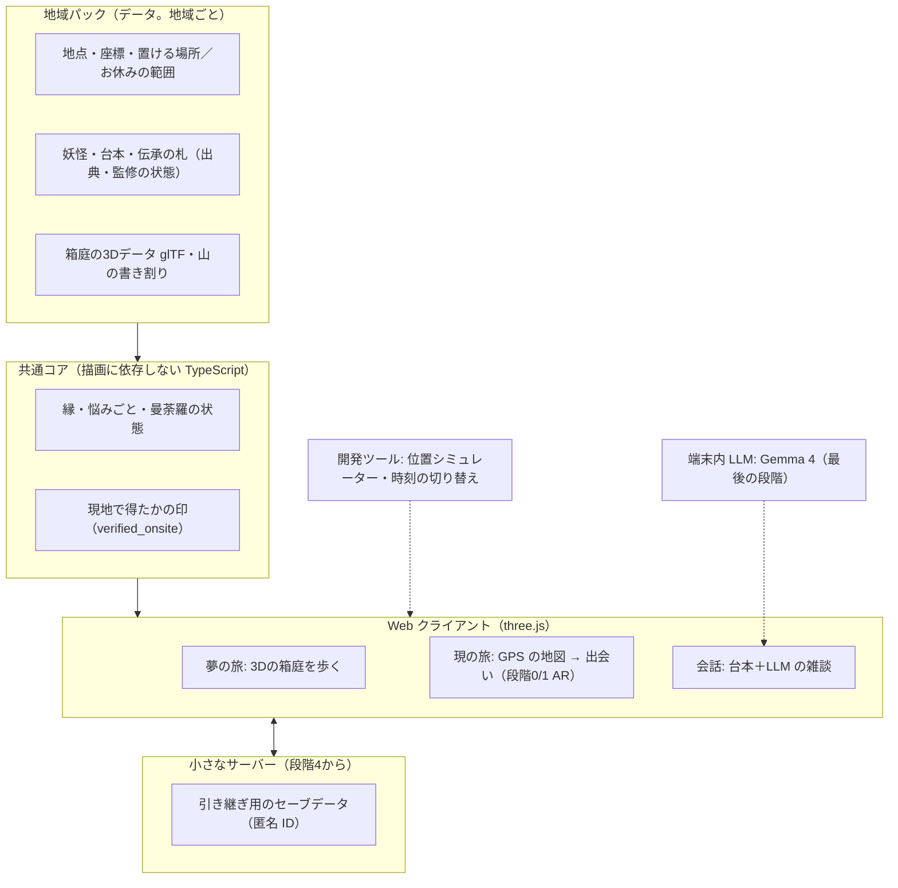

# 全体整理とロードマップ v0.3

> 作成日: 2026-10-16 ／ ステータス: **10/17 PO 決定（推奨どおり）。§9 の提案はすべて決定**
> 00〜04 の内容と、10/16 の議論（家から遊ぶモード、3D の見た目、現地限定の「行った証」）を一本にまとめたもの。
> **00〜04 と食い違うところは、この文書を優先する**（直す箇所は §10）。v0.2 で独立レビューの指摘を反映した。v0.3（10/17）で、LLM を最後に端末内で動かす方針と、公開先（GitHub Pages）を反映した。10/17 に PO が「推奨どおりで順に進める」と決め、§10 の差分は 02・04 の v0.2 に反映した（01 の2行を除く）。
> 表記: 【創作】＝本作の作り話。

## 1. ひとことで

**家では、立山の3Dの箱庭を歩いて妖怪の物語を聞く。現地では、同じ場所に本当に立って、その妖怪に「再会」する。**
three.js で作る Web ゲームで、PC とスマホの両方で遊べる。最初の地域は立山・富山で、あとから他の地域を「地域パック」として足していく。

## 2. 決まっていること・確認待ちのこと

### 2.1 決定済み（02 §1）
| 項目 | 内容 |
|---|---|
| ターゲット | 20〜40代の「和もの好き」の大人 |
| トーン | やさしさが基調で、ときどき畏れ |
| 地域 | 立山・富山 |
| 事業 | 基本無料＋地域タイアップ |
| 技術 | three.js による Web ファースト |

### 2.2 10/16 の方向 → 10/17 決定（推奨どおり）
| 項目 | 内容 |
|---|---|
| MVP の舞台 | 「麓」（岩峅寺・芦峅寺）と「里」の一部（02 v0.2 §4.1 に反映） |
| 家のモード | 家から遊ぶモード（夢の旅）を主要モードにする。地域を選んで、3Dの箱庭に入って歩ける |
| 見た目 | ポケモンGOより立体的な、ゲームらしい3D。参考画像ボードの方向で進める |
| 現地限定 | 現地に行った人だけが手に入れられる「行った証」を作る |
| 世界展開 | 遊べる地域を選んで入る形にし、地域パックを増やして広げる |

## 3. ゲームの全体像：二つの旅

| | 夢の旅（家・PC／スマホ） | 現の旅（現地・スマホ） |
|---|---|---|
| 入り方 | 地域を選ぶ → その土地の3Dの箱庭に入る | 現地で GPS の地図を開く |
| 動き方 | アバター（絵解き師の見習い）と相棒のましろで歩く。名所で「指を置いて耳を澄ます」と、数秒で妖怪の姿が浮かぶ（家版の「立ち止まる」） | 自分の足で歩く。立ち止まると妖怪が現れる |
| 妖怪の姿 | 白描（墨の線だけ）の「夢の姿」 | 色のついた本当の姿 |
| 会話 | 台本。のちに「なじみ」になった妖怪とは LLM の雑談もできるようにする（§5.2） | 台本（のちに LLM の雑談）。本人がその場所でだけ話すことがある |
| 悩みごと・鎮め | 家でも始めて、解ける | 現地でも始めて、解ける |
| 物語 | **最後まで進められる**。打ち明け話は、古笠の便りやましろの「また聞き」として読める | 同じ打ち明け話を、妖怪本人がゆかりの地点で語る |
| 縁 | 「顔見知り」→「なじみ」まで | 「語り仲間」「えにし」まで上がる |
| 曼荼羅 | 白描（線）まで | 色が入る。家で語り返すと金の縁取り |
| 行った証 | 枠だけ見える | 日付入りの「旅印（仮）」 |

**再会の仕組み**: 家で先に会った妖怪は、現地で【創作】「夢で見た顔だな……本当に来たのか」と迎える。家で遊んだことが、現地の驚きを減らすのではなく、増やすように作る。

### 3.1 二つの旅のルール（最初に公開して、後から削らない）

ポケモンGOは、2020年に家で遊べるようにした仕組みを2023年に絞り、大きな反発を受けた（2025年に一部を戻した）。その教訓から、境界は最初に決めて公開する。

1. 家の遊びを不利にして現地へ行かせるのではなく、現地で上乗せする。
2. 物語の本編は、現地に行かなくても最後まで遊べる（遠くに住む人、行けない事情のある人のため）。
3. 現地でしか手に入らないのは「色・語り仲間とえにし・旅印・その場でしか聞けない台詞」。

### 3.2 「行った証」のルール

| 決まり | 理由 |
|---|---|
| 「御朱印」「お守り」と呼ばない。見た目も似せない（朱の印と墨書きの組み合わせ、お札・袋・紐の形を使わない） | 神社本庁は御朱印を「参拝した証」としている。彌彦神社・大神神社などは授与品を「購入した品物ではない」として転売を戒めている。模造品を集めさせると、ここにぶつかる |
| 旅印（仮）は、駅スタンプのようなインク1色の絵柄スタンプにして、曼荼羅帳の巻末に押す | 宗教と関係のない「印を集める」文化は大きい（御船印 累計約78万枚＝2026年3月まで・一部推計、マンホールカード 1,050万枚＝2023年7月時点）。新しい帳面は増やさず、曼荼羅帳を旅の一冊にする |
| お金では売らない。人に譲れないようにする | 転売や行列を防ぐ |
| 本物の御朱印・お守りは、ゲームの外の正式なものとして扱う。ゲームの進行やご褒美とは結びつけない | 雄山神社の考えは未確認。案内するのは了承を得てから |
| **MVP（3月のテストまで）は GPS だけで確かめる**。偽装は許容する。協力先に置く NFC タグ（コピーできない方式）は、旅印のためにテストの後で検討する | Web の位置情報は簡単に偽装できる。ただ MVP の段階では、守る価値と手間が釣り合わない |

**位置情報の扱い**: サーバーには移動の履歴も GPS の座標も残さない（02 F-52）。「現地で得た」という印は、セーブデータの中のフラグとして持つ。

## 4. 見た目の方向（仮置き。参考画像ボードの問いの答えで直す）

> 10/17: 夢の旅の箱庭の見た目は [06](06-art-direction.md)「光と霞」で具体にし、06 §7 のとおり決まった（光と霞を標準、最初の時間帯は昼、未訪問は白描で淡く→段階2の後、夜の窓の灯りを入れる）。カメラの既定の距離は 62m。

| 項目 | 仮の方向 | 参考 |
|---|---|---|
| 外を歩くときの地図 | 和風の3Dの街並みに、地名の札が浮かぶ（社寺名は了承を得るまで出さない） | 信長の野望 出陣 ＋ ポケモンGOのすっきり感 |
| 家から入る3Dの箱庭 | 斜め上から見下ろす小さな箱庭。山へ向かって登っていく構成 | あつまれ どうぶつの森、A Short Hike |
| 絵のタッチ | やわらかい里山の3Dに、墨の線をアクセントにする。白描（夢）→彩色（現）が、そのまま見た目の切り替えになる | 天穂のサクナヒメ、大神 |
| 妖怪の描き方 | 切り絵のような板の絵を、3Dの空間に立てる（04 §3.1 のまま。絵の量を抑える） | ― |
| 畏れの度合い | 道しるべの行灯と朱い月の、静かな夜の不気味さまで（06 §2.3。社寺の灯籠は描かない） | Kage |
| 他のプレイヤー | MVP は一人で遊ぶ。次に、歩いた跡や灯りが残る形 | ピクミン ブルーム、Sky |
| 遠くの山 | 立山連峰を、標高データから作った切り絵の書き割りで見せる | A Short Hike の霞んだ遠景 |
| 地域を選ぶ画面 | 吉田初三郎の富山鳥瞰図（1932・1936年、日文研所蔵）の構図を手本にする | 使う前に日文研へ連絡する |

### 4.1 箱庭の範囲と置き方
- 箱庭は「街全体の複製」にしない。数百m四方の小さな場所にする。家から行ける3D空間には、人がいない・やることがないまま終わった例がある（バーチャル大阪、メタバース・ソウル）。空間は、妖怪の悩みをほどくための舞台にとどめる。
- **作るのは境内の外の公道と広場だけ。** 社殿・鳥居・宿坊・個人の家は作り込まず、霧か名前のない一般的な家並みにする。社寺名や地名の札は、了承を得るまで「この地点」と書く（04 §5.2）。布橋のまわりは、関係者の了承と第三章の判断（2月初め）が出るまで箱庭に入れない。
- 箱庭の妖怪の位置は、現地の地点と同じにする。04 §3.1 の「置ける場所」のルール（歩道のある道・広場・公園だけ。住宅の前・境内・宿坊は不可）に従う。にぎやかさは、地点を近づけて描く写し方で出す。地点の数は増やさない。
- **岩峅寺の箱庭の範囲（10/17 決定）**: 原点（OSM の社寺の点）から西200m・東500m・南北200m（700m×400m）。東へ広げて、集落と岩峅寺駅を入れた。建物は OSM に描き足して取り込む（アカウントが要る外部への公開作業なので PO の作業）。それまでは名前のない仮の家並みを置く（04 §3.8、02 F-26）。
- 箱庭の大きさは数百m四方に限るので、01 の「Unity に移る出口条件」の「広い3D空間」には当たらないと判断する。段階1の計測で 30fps が出なければ、見直す。

## 5. 仕組みの全体図

- **夢の旅の箱庭と、開発用の位置シミュレーターは別物にする。** シミュレーターは、本物の座標の地図に、瞬間移動・歩行の再生・時刻の切り替えを重ねただけの道具。共通にするのはデータとロジック。
- **データには実際の緯度経度を持たせる。** 箱庭への写し方（名所を近づけて描く変換）は、地域パックごとに決める。
- **データの形は最小から始める。** 段階1では「地点・座標・箱庭への写し方」だけにし、段階ごとに項目を足す。
- **出会いやご褒美には、最初から「現地で得たか」の印を持たせる。** 同じ中身でも、現地で得たものは格が上がる。
- **公開先は GitHub Pages にする**（リポジトリは公開設定）。`.github/workflows/yokai-pages.yml` がビルドして公開する。PO にリポジトリの設定で Pages を有効にしてもらう。GPS を使うページは HTTPS の URL が必要で、Claude のアーティファクトでは位置情報が使えない。アーティファクトは、PO が見た目をすぐ確かめるための補助に限る。

### 5.1 地図・地形データの方針

| データ | 使い方 | 条件 |
|---|---|---|
| OpenStreetMap | 道・川・建物の形から、箱庭の下地を作る | ODbL。生成スクリプトと手順を無償で公開し、配る地形データは ODbL で提供する。妖怪や物語などの独自データは別ファイルに分ける。tile.openstreetmap.org は製品では使わない（自前でタイルを作る）。**地方は建物データが薄いことがあるので、段階0で岩峅寺まわりの量を確かめる** → 岩峅寺は空中写真の半分ほどだった。建物は OSM に描き足してから取り込む（PO の作業。10/17 決定）。それまでは仮の家並み |
| 国土地理院の標高タイル | 立山連峰の山並みと、足元の地形 | 出典を表示し、加工した旨を書く。事前に加工して配る場合に申請が要るかは、国土地理院に確認する |
| PLATEAU（国交省の3D都市モデル） | 富山市・立山町は未整備なので、MVP では使わない。整備済みの高岡市は、2つ目の地域の検証に使える | 出典と加工の旨を書けば商用可 |
| Google のリアルな3D地図 | **使わない** | 和風への作り変え、キャッシュ、ほかの地図との併用が規約で制限されている |

### 5.2 LLM は最後に、端末内で動かす（10/17 決定）
- 妖怪との雑談の LLM は、作る順番の最後に回す。クラウドの API は使わず、**端末内で Gemma 4（E2B／E4B）を動かす**。そのため、LLM の中継サーバー・API のアカウント・従量課金は要らない。
- 端末内で動かすには、メモリ8GB程度が目安（E2B。調査記事による値で要確認）。Web では WebGPU（iOS 26 の Safari から標準で有効）で動かす方法と、アプリの殻に包む方法がある。どちらにするかは、その段階で iPhone で測って決める。モデルのダウンロード（約2GB）を、どこで・いつしてもらうかも決める。
- それまでは、会話はすべて台本で作る。04 §3.2 の「台本と LLM の境界」と安全策（伝承の作り話をさせない、渡してよい札の表）は、そのまま端末内 LLM にも当てはめる。
- 影響: 仮説 H3（LLM の会話による愛着）は、3月の現地テストまでは確かめられない。3月のテストは台本だけで行い、H3 はその後に確かめる。

## 6. どこから作るか（作る順番）

各段階で「遊べるもの」が1つでき、関門（次に進む条件）を確かめてから進む。

| 段階 | 時期 | 作るもの | 関門（誰が・何を見るか） |
|---|---|---|---|
| **0. 土台** | 10/17〜10/23（4〜5日） | 雛形（Vite＋TypeScript＋three.js）、公開先（画面＋サーバーの土台）、最小のデータ形式。**データの下見**（岩峅寺の前立社壇を中心に300m四方の OSM の建物数・タグの付き具合、標高タイル DEM5A が取れるか）。計測に使う実機（中位の Android 1台と iPhone 1台）と fps の測り方 | OSM から自動で作るか、OSM を下絵にして手で置くかを決める |
| **0.5 GPS の検証** | 10/24〜10/28（2〜3日。PO が地元を歩く） | 素の地図で、画面を開いたままポケットに入れて30分歩く。位置の取れ方、電池、立ち止まりの判定 | ゲームの核の「立ち止まると現れる」が成り立つか。ここが一番の技術リスク |
| **1a. 夢の旅の骨組み** | 10/24〜10/31 | 灰色の箱の地形、仮のアバターとましろ、斜め見下ろしのカメラ、スマホのタッチ操作と PC の操作。**初日に実機で fps を測る** | PO と身近な2〜3人。中位のスマホで 30fps、歩いて気持ちいいか（5段階） |
| 1b. 箱庭らしく | 11月前半（段階2と並行） | OSM と標高から下地を作る仕組み、立山連峰の書き割り、カメラの角度・縮尺・色の調子 | 見た目の方向が参考ボードと合っているか（PO） |
| 2. 出会いと会話 | 11月前半〜中旬 | 光蔵坊1体。気配 → 耳を澄ます → 夢の姿 → 台本の会話 → 札が開く → 曼荼羅のピース | 妖怪と話すのが楽しいか（H1 の一部）。家の動詞「耳を澄ます」が成り立つか |
| 3. 現の旅 | 11月後半に作り、12月第1週にテスト | 素の地図に札を重ねる形で、地元のテスト用パックを歩く。立ち止まると色のついた姿で現れる（段階0/1 AR）。彩色、旅印（仮）。家の側は、地元パックでは白描の2D だけにする | 5〜8人で 04 §6.3・§6.4 の基準。H1 を見る。H3（LLM）と H4 はここでは測らない |
| 4. 遊びの仕組み | 12月（2〜3週に絞る） | 悩みごと3型、縁の5段階、鎮め、夜話・便り、引き継ぎ（匿名 ID＋引き継ぎコード） | 1月第2週に1週間のおうちテスト（H1・H2） |
| 5. 麓の作り込み | 1〜2月 | 岩峅寺から芦峅寺までの物語を章ごとに作り、1月から章ごとに監修へ送る。和風の3D地図。本番の絵は「光蔵坊と主要な2〜3体＋箱庭1か所」まで | 3月の麓での現地テスト（10〜20人）。H4 は 04 §6.3 の方法で確かめ、「家で会った妖怪に現地で再会して嬉しかったか、作業に感じたか」を聞き取りに足す |
| 6. 端末内 LLM | 3月のテストの後 | Gemma 4 を iPhone で動かす（WebGPU か、アプリの殻か）。「なじみ」以上の妖怪との雑談、安全策、渡してよい札の表 | H3（LLM の会話による愛着）を、台本だけの場合と比べる |

> **進み具合（10/17）**: 段階0〜2 に続いて、**段階3の仕組み（3a）を先に作った**（`apps/yokai-game/utsutsu.html`）。素の地図（OSM から自前で描く）、気配と鈴、立ち止まると澄む（「足を止めた」ボタンつき）、色のついた姿（AR 段階0・1）、光蔵坊の現地の台本（夢で会っていれば再会）、彩色、旅印（仮）と曼荼羅帳の巻末、道中・お休みの範囲・逢魔が時・夜の止め方、三つの約束、位置シミュレーター（F-06）、**テスト用の土地**（F-07。いまいる所のまわりの OSM を読み、端末の中だけに作る）。
> 残り（3b）: ガメとミノモシ（台本と絵）、出現の表（水辺）、とりもつ1・調べる→鎮め1、家の側の白描の2D（地元パック）。実機（iPhone）で歩いて確かめるのは、GitHub Pages を有効にしてから。

**打ち切りの規則**
- 段階1a が 10/31 に終わらなければ、1b（OSM から作る仕組み）は段階5へ回し、箱庭は手で置く。
- 段階1a で 30fps が出ない、または歩いて楽しいと感じられなければ、11月前半に夢の旅を「絵地図の名所をタップして跳ぶ」形（道中双六）に切り替える。
- 段階0.5 で、ポケットに入れて歩いたときに位置が取れなければ、現の旅の歩き方（「話すときだけ止まる」など）を段階3の前に作り直す。

**段階1から始める理由と、採らなかった反対意見**
- いちばん見たいもの（three.js の立体的なゲーム感）を最初に形にでき、見た目のすり合わせも静止画より速く進む。家で開発し、家で確かめられる。箱庭を作る仕組みは、地域パックを増やすときの土台になる。
- 調査メモの批評は「歩ける箱庭は3月までには重い。MVP は名所をタップして跳ぶ形にし、歩ける箱庭は3月の結果を見て決める」と勧めていた。PO が「歩ける3D」をはっきり望んでいるので、この案は採らなかった。そのリスクは、上の打ち切りの規則（10月末と11月前半の関門）で扱う。

## 7. 並行して進めること（人の仕事）

| いつまで | やること | 担当 |
|---|---|---|
| 10月末 | **お金の上限**: 3月までの総額、下見とテストの交通費・宿代（LLM は端末内なので API の費用はかからない） | PO |
| 10月末 | **GitHub Pages の設定**: Settings → Pages → Source を「GitHub Actions」に。Settings → Environments → github-pages で、開発ブランチ（claude/*）からのデプロイを許可 | PO |
| 10月末 | 計測用の実機: iPhone は PO の手持ちを使う。中位の Android は、3月のテストの前までに借りるか買うかを決める | PO |
| 11月中旬（遅くとも12月上旬） | **麓の下見**（雪が降る前に）。地点と予備地点の写真、境内の範囲、交通、環境音の録音、日の入りごろの明るさ、将来タグを置ける候補の場所 | PO（Claude が調査項目の一覧を作る） |
| 11月中 | 立山博物館への最初の連絡（監修、クタベの協業）。文案は 08 | PO |
| 下見の前後（08 §0.1 の案(a)・案(b) から PO が選ぶ） | 雄山神社への相談（3Dで周辺を描いてよいか、地点の扱い、本物の授与品の案内）。案(a) は博物館と同時に10月末〜11/2、案(b) は下見の後の11月下旬（下見は公道からの記録だけ） | PO |
| 10月末（08 の文案を送る前） | 箱庭のない場所（里・芦峅寺）を家で遊ぶ形の決定（04 §3.8・§7）。「家だけでも最後まで遊べる」は公開後に削らないルールなので、外部に伝える前に決める | PO |
| 11月末 | 3Dアーティスト・イラストレーターの候補（12月中旬に契約） | PO |
| 12月 | 布橋灌頂会実行委員会と芦峅女性の会への相談 | PO |
| 10月中（遅くとも12月まで） | 日文研（鳥瞰図の利用）と国土地理院（加工したデータを配るときの申請）への問い合わせ。文案は 08 | PO（Claude が文案） |
| 12月中（最終1月末） | 監修者の決定 | PO |
| 1月 | 3月のテスターの募集（18歳以上、10〜20人）、同意書 | PO |
| 2月中旬 | テスターに夢の旅を配る（現地の前に家で遊んでもらう） | PO・Claude |
| 2月末 | 雪で決行するか、4月以降にずらすかの判断。日程は 3/13（お召し替え）を避ける | PO |

監修者が1月末までに決まらない場合は、04 §6.5 のとおり、3月のテストを「監修前の試作」と明示し、03 で確認済の札だけで行う。第三章は2月初めまでに了承がなければ、代わりの形にする。

## 8. スケジュール（まとめ）

| 時期 | 作る（Claude） | 人の仕事（PO） |
|---|---|---|
| 10/17〜10/23 | 段階0（土台、データの下見） | お金・アカウント・実機 |
| 10/24〜10/31 | 段階1a（箱庭の骨組み） | 段階0.5 GPS の検証（地元を歩く）、段階1a を触る |
| 11月前半 | 段階1b・段階2（出会いと会話） | 下見の日程、博物館へ連絡 |
| 11月中旬 | 下見の結果を地域パックに反映 | **下見**、雄山神社への相談 |
| 11月後半 | 段階3（現の旅）を作る | 作家の候補探し、テスター集め（5〜8人） |
| 12月第1週 | 段階3のテスト | 地元でのテストの付き添い |
| 12月 | 段階4（遊びの仕組み） | 実行委員会・芦峅女性の会へ相談、作家と契約、監修者 |
| 1月 | 段階5（章ごとに作り、監修へ） | 1月第2週におうちテスト、テスター募集 |
| 2月 | 段階5（続き）、テスターへの配布 | 雪の判断 |
| 3月 | 現地テストの準備と実施 | **麓での現地テスト（10〜20人）** |

## 9. 10/17 決定（推奨どおり）

PO は 10/17 に「推奨どおりで順に進める」と決めた。下の提案は、すべてそのまま決定とする。

| # | 決めたこと | 決定（10/17、推奨どおり） |
|---|---|---|
| 1 | 作る順番（段階0 → 0.5 → 1a から始める）と打ち切りの規則 | 決定。10/17 開始済み |
| 2 | 参考画像ボードの問い | §4 の仮置きで始め、段階1を触ったあとに直す |
| 3 | 家と現地の線引き（§3 の表とルール） | このまま公開する |
| 4 | 「行った証」の形 | 旅印（仮）を曼荼羅帳の巻末に押す。「まもり」という名前はやめ、妖怪からの品は 04 の供物・贈り物の枠で扱う |
| 5 | PC とスマホのデータ | 段階4で匿名 ID＋引き継ぎコードを作る（PC の家の旅と、スマホの現地の旅をつなぐ）。会員登録は求めない |
| 6 | GDD（04 §7）の6つ | 推奨どおりで仮置き。例外は2つ。#1 の「PC 版は後回し」を取り消す。#3 の段取りは本書 §6 に置き換える（04 v0.2 §7 に反映） |

## 10. 既存文書との差分（この文書が優先）

| 文書 | 箇所 | 変更 | 状態 |
|---|---|---|---|
| 00 | §3 コアループの図 | 「御朱印のような記録」をやめ、曼荼羅帳と旅印にする | 反映済み |
| 01 | 段階3の代替案 | 「御札マーカー」を「絵札マーカー」に。置く場所は了承を得た協力先（博物館・案内所・駅）の案内板 | 反映済み |
| 01 | 画風・出口条件 | 画風を「2.5D の切り絵」から「3Dの箱庭に、切り絵の板の妖怪を立てる」へ。箱庭は数百m四方なので出口条件には当たらない（§4.1） | 未反映 |
| 01 | 検証スパイク | GPS の検証を段階0.5 に前倒し | 未反映 |
| 02 | F-01 和風地図 | 外の地図は、MVP では素の地図＋札。和風の3D地図は段階5 | 反映済み（v0.2） |
| 02 | F-25 おうちモード | 「夢の旅」に名前を変え、3Dの箱庭を歩けるモードとして Must。本文の「新しい出会いは現地でしか起きない」は、§3 の線引きに置き換える | 反映済み（v0.2） |
| 02 | F-06 位置シミュレーター | 夢の旅とは別の、開発用の道具として残す | 反映済み（v0.2） |
| 02 | F-50・F-51・F-52 | 登録なしで始める（F-50）は維持。引き継ぎ（F-51）は Must に上げ、匿名 ID で実装。位置の履歴をサーバーに残さない（F-52）は維持 | 反映済み（v0.2） |
| 02 | F-72 協力先の枠 | 旅印の協力先を見据えて Should に上げる（NFC はテストの後） | 反映済み（v0.2） |
| 02 | §2 H4 | 確かめ方は 04 §6.3 のまま。再会についての聞き取りを足す | 反映済み（v0.2） |
| 02 | §3 ペルソナ・§6 非機能 | 「おうちモード」を「夢の旅」に。最初の読み込み10MB に3Dの箱庭を含めるかは、段階1で測って決める | 反映済み（v0.2） |
| 02 | §4.1・§4.3 | 夢の旅の箱庭の範囲（境内の外の公道・広場）を足す | 反映済み（v0.2） |
| 02 | §8 体制・§9 スケジュール | 3Dアーティストを足す。スケジュールは本書 §8 | 反映済み（v0.2） |
| 04 | §2.1 序の口 | 家で始めた場合も、夢の旅で最初の妖怪に会える | 反映済み（v0.2） |
| 04 | §3.1 出会い | 家の出会い方「耳を澄ます」を足す。妖怪は板の絵のまま | 反映済み（v0.2） |
| 04 | §3.2 会話 | LLM は最後の段階で、端末内の Gemma 4 で足す。それまでは台本だけ。家でも「なじみ」以上で雑談できるようにする。クラウドの費用の見積もりは不要になる | 反映済み（v0.2） |
| 02 | §6 非機能（費用・会話の速さ） | LLM の費用の上限は不要。会話の速さの目標は端末内 LLM の段階で決め直す | 反映済み（v0.2） |
| 04 | §3.3 縁 | 家で上がるのは「なじみ」まで。「語り仲間」「えにし」は現地 | 反映済み（v0.2） |
| 04 | §3.4 悩みごと・§3.5 鎮め | 家でも始めて解ける | 反映済み（v0.2） |
| 04 | §3.6 曼荼羅 | 白描→彩色を、箱庭と地図の見た目の切り替えにも使う。くらがりの例外は維持 | 反映済み（v0.2） |
| 04 | §3.8 おうちモード | 「新しい出会いは現地だけ」「スマホだけ」をやめ、§3 の線引きにする。PC でも遊べる | 反映済み（v0.2） |
| 04 | §4.2 主ストーリー | 打ち明け話は、家ではまた聞き、現地では本人が語る。終章（絵解き）は家でも結べる。**終章のピースの色とましろとのえにしは現地**。家の終章の場所は白描の絵地図の山の見える名所（案。04 §3.8、PO の確認待ち） | 反映済み（v0.2。10/17 に言い方を直した） |
| 04 | §6.1〜§6.5・§7-1・§7-3 | 段取り・作る範囲・テストの人数は本書 §6〜§8 に置き換える。判定の基準（§6.4）は段階3のテストで使う | 反映済み（v0.2） |

02・04 の行は、10/17 の決定を受けて 02 v0.2・04 v0.2 に反映した。01 の2行（画風・出口条件、検証スパイク）は未反映のまま残っている（01 の更新は別の作業）。

## 参考（今回の調査）
- 調査メモ（出典付き）: [research/2026-10-16-home-mode.md](research/2026-10-16-home-mode.md)。ポケモンGOのリモートレイドの経緯、ドラクエウォークのおみやげ、御船印・マンホールカード、寺社の授与品と転売への対応、デジタル御朱印、現地チェックの方式（NFC タグ・QR）、地図データの条件、自治体メタバースの教訓など
- PLATEAU オープンデータ一覧: https://www.mlit.go.jp/plateau/open-data/
- 国土地理院コンテンツ利用規約: https://www.gsi.go.jp/kikakuchousei/kikakuchousei40182.html ／ 地理院タイル一覧: https://maps.gsi.go.jp/development/ichiran.html
- OpenStreetMap の著作権とライセンス: https://www.openstreetmap.org/copyright ／ Produced Work のガイドライン: https://osmfoundation.org/wiki/Licence/Community_Guidelines/Produced_Work_-_Guideline
- Google Map Tiles API のポリシー: https://developers.google.com/maps/documentation/tile/policies
- 日文研 吉田初三郎式鳥瞰図データベース（「富山」「富山市」）: https://www.nichibun.ac.jp/
